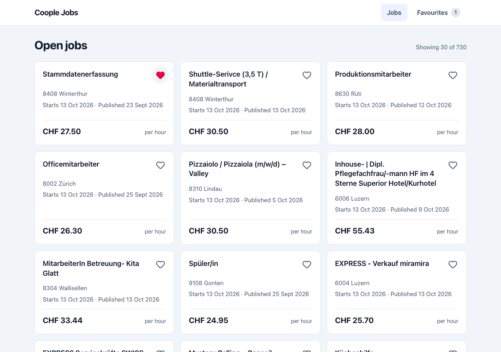
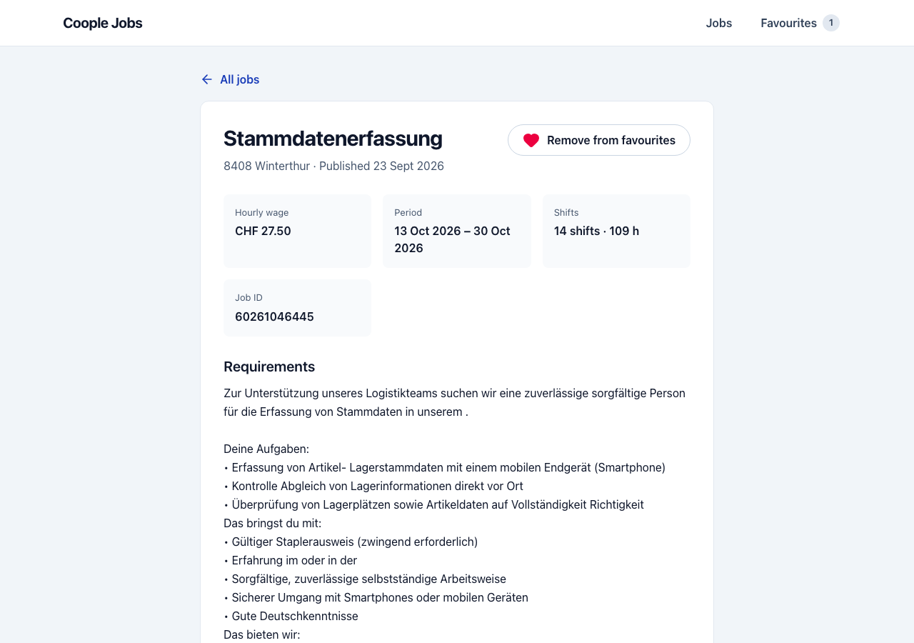
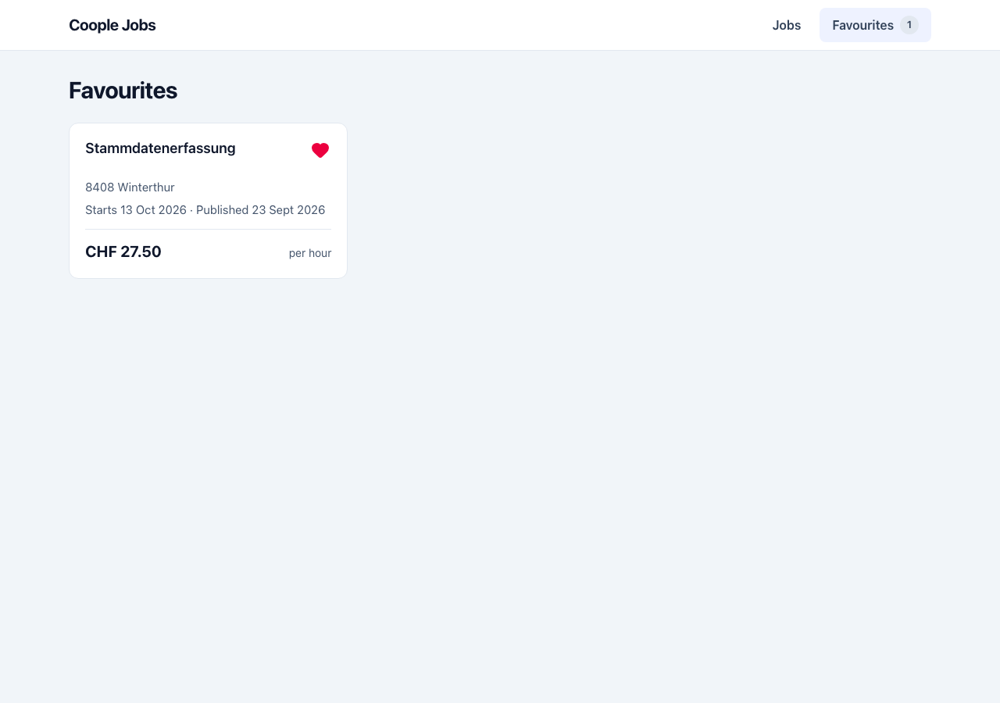

# Coople Jobs

A small two-screen app on top of the public Coople jobs API: a job list with infinite scroll, a job details screen (`/job/:id`) and Favourites.

**Live demo:** https://jobs-explorer-production.up.railway.app





## Setup

Requires Node 22+.

```bash
npm install
npm run dev          # http://localhost:5173
```

Or without Node on the host:

```bash
docker compose up --build   # http://localhost:8080
```

### Scripts

| Script             | What it does                                                    |
| ------------------ | --------------------------------------------------------------- |
| `npm run dev`      | Vite dev server with the `/api` proxy                           |
| `npm run check`    | typecheck, lint, format check, knip, tests with coverage, build |
| `npm test`         | unit and component tests (Vitest, Testing Library, MSW)         |
| `npm run test:e2e` | Playwright, API mocked with `page.route`                        |
| `npm run build`    | production build                                                |

## Architecture

Frontend only: Vite, React, TypeScript (strict), Tailwind v4 with shadcn-style components, TanStack Query and Router, zustand, zod.

- **Layers:** `routes → pages → components → store → api → entities`, enforced by ESLint (`eslint-plugin-boundaries`). Components never call the API directly.
- **Entities:** zod schemas in `src/entities`; types are inferred from them.
- **API:** `Api` → `JobsResource` → `HttpClient`. The client unwraps the `{ status, data, error, … }` envelope, validates `data` with zod and throws `ApiError` of kind `network`, `http` or `schema`.
- **Server state:** TanStack Query. The API sends `cache-control: no-store`, so Query does the caching (`staleTime` 5 min, no refetch on window focus; the list is not refetched on mount either, so a stale list does not re-request every loaded page). 4xx (except 408/429) and schema errors are not retried, network errors, 5xx, 408 and 429 are retried twice. Cancelled queries abort their `fetch`. The list is de-duplicated by job id, since offset pages can overlap when new jobs are published. Dates are shown in Swiss time (`Europe/Zurich`).
- **Favourites:** zustand `persist` in **`localStorage`** (`coople:favourites`). A job is saved as a small preview, so the Favourites page renders without requests. Stored data is validated with zod on read, entry by entry: a broken entry (or one whose key is not its own job id) is dropped, the rest is kept. Other open tabs reload favourites on the `storage` event, so a stale tab does not overwrite them. Chosen because it is synchronous, needs no backend and survives reloads.
- **States:** every request has loading (skeleton), error (with Retry) and empty states; details also has not-found (404 or a non-UUID id — no request is made for the latter, the API answers 401 to it).

Details: [docs/architecture.md](docs/architecture.md), quality gates: [docs/quality.md](docs/quality.md), reasons behind the key decisions: [DECISIONS.md](DECISIONS.md).

### CORS and the `/api` proxy

The Coople API sends no CORS headers, so the browser cannot call it from another origin ([docs/api-cors.md](docs/api-cors.md)). The app always calls the relative `/api`, which is proxied to `https://www.coople.com/ch/resources/api`:

| Mode              | Proxy                                 |
| ----------------- | ------------------------------------- |
| `npm run dev`     | Vite `server.proxy`                   |
| `npm run preview` | Vite `preview.proxy`                  |
| Docker / Railway  | nginx (`nginx/default.conf.template`) |

The base URL comes from `VITE_API_BASE_URL` (set in `.env.development` and `.env.production`; see `.env.example`). Env variables are validated with zod at startup, and a missing one throws.

**Why `.env.development` and `.env.production` are committed:** this is a client-side app. Every `VITE_*` value is inlined into the public JS bundle at build time, so anyone can read it in the browser, and hiding it would add nothing. They hold only non-secret config (the relative `/api` path), so they live in the repo and the Railway service needs no variables set. Real secrets must never use the `VITE_` prefix; the only secret here, `RAILWAY_TOKEN`, is a GitHub Actions secret and never reaches the bundle.

### Deployment

Live: https://jobs-explorer-production.up.railway.app (Railway project `jobs-explorer`, service `jobs-explorer`, environment `production`). Build and healthcheck settings are in `railway.json`.

The `Dockerfile` builds the app and serves it with nginx on `$PORT`, which also proxies `/api`. CI (`.github/workflows/ci.yml`) runs all checks and never deploys. Deploys are manual: run the `Deploy` workflow (`.github/workflows/deploy.yml`, Actions tab → Deploy → Run workflow) on the ref you want; it runs `railway up --ci` and needs the `RAILWAY_TOKEN` repository secret and a Railway service.

## Assumptions

- `currencyId: 1` is shown as CHF; other currencies show the bare amount.
- `workDuration` is treated as minutes.
